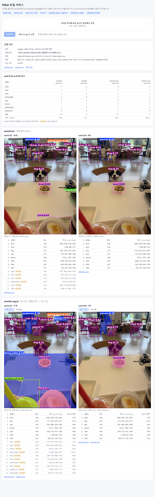
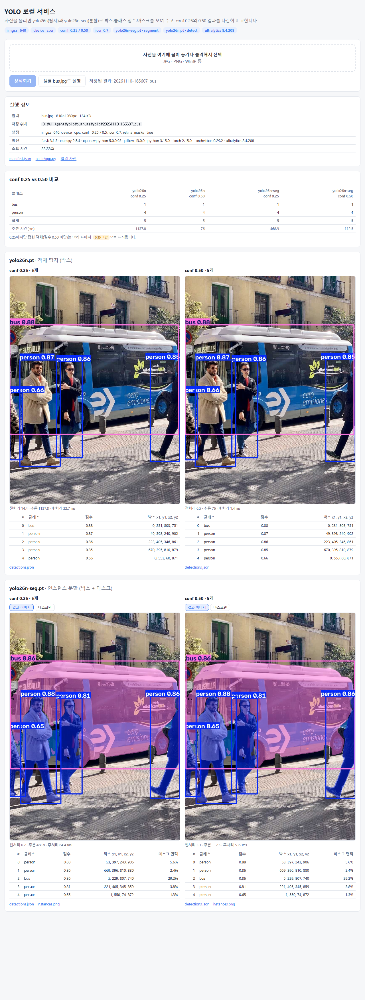

# 과제 제출: YOLO 서비스

**저장소:** https://github.com/jsseo0420/ai-agent-yolo

사진을 올리면 **yolo26n(탐지)**과 **yolo26n-seg(분할)**로 박스·클래스·점수와 마스크를 보여 주는 로컬 웹 서비스입니다. **conf 0.25와 0.50 결과를 나란히 비교**할 수 있습니다. 실행할 때마다 결과 이미지, 박스 좌표 JSON, 마스크 PNG, 실행 코드 사본, `manifest.json`을 파일로 저장합니다.

| 문서 | 내용 |
|---|---|
| 이 문서 | 실행 위치, 실행 방법, 도구·설정 선택 이유, 처리 범위와 한계 |
| [docs/REVIEW.md](docs/REVIEW.md) | **원본 대조 기록:** 검출 하나하나를 원본 위치와 맞대어 본 판정, 미탐 목록, 확인 필요 항목 |
| [outputs/yolo/](outputs/yolo/) | 실제 실행 결과 2건 (bus, cafe) |

---

## 1. 결과 화면

서비스 화면을 그대로 캡처했습니다. 저장된 실행 결과를 `/?run=<실행 폴더 이름>`으로 다시 불러온 화면입니다.

| cafe.jpg | bus.jpg |
|---|---|
| [](docs/screenshots/service_cafe.png) | [](docs/screenshots/service_bus.png) |

**결과 요약** (판정 근거는 [docs/REVIEW.md](docs/REVIEW.md))

| 사진 | 모델 | conf 0.25 | conf 0.50 |
|---|---|---|---|
| bus.jpg | yolo26n | 5개 (정탐 5) | 5개 (정탐 5) |
| bus.jpg | yolo26n-seg | 5개 (정탐 5) | 5개 (정탐 5) |
| cafe.jpg | yolo26n | 14개 (정탐 10 · 오탐 2 · 확인 필요 2) | 8개 (정탐 8) |
| cafe.jpg | yolo26n-seg | 17개 (정탐 13 · 오탐 2 · 확인 필요 2) | 7개 (정탐 7) |

---

## 2. 어디서 실행되는가

| 항목 | 값 | 기록 위치 |
|---|---|---|
| 실행 장소 | **로컬 PC**, Windows 11 Pro (10.0.26200), Intel i7-9750H | `manifest.json` → `execution.platform` |
| 프로젝트 폴더 | `D:\AI-Agent\yolo` | `execution.working_directory` |
| Python | 프로젝트 가상환경 `.venv` (Python 3.15.0) | `execution.python_executable` |
| 서비스 주소 | `http://127.0.0.1:7860`. **이 PC 안에서만 접속**할 수 있고, 사진이 외부로 전송되지 않습니다. | `execution.server_url` |
| 연산 장치 | **CPU**. PC에 GTX 1650 GPU가 있지만 설치된 PyTorch가 CPU 전용(`2.15.0+cpu`)이라 쓰지 않았습니다. | `settings.device` |
| 외부 통신 | 첫 실행 때 Ultralytics GitHub에서 모델 파일(`.pt`)을 한 번 내려받는 것뿐입니다. | — |
| 결과 저장 | `outputs/yolo/<YYYYMMDD-HHMMSS>_<파일명>/` | `execution.run_dir` |

**패키지 버전** (`manifest.json` → `versions`): ultralytics 8.4.208 · torch 2.15.0 · torchvision 0.29.2 · opencv-python 5.0.0.93 · numpy 2.5.4 · pillow 13.0.0 · flask 3.1.3

---

## 3. 실행 방법 (재실행 절차)

```bash
git clone https://github.com/jsseo0420/ai-agent-yolo.git
cd ai-agent-yolo
python -m venv .venv
.venv\Scripts\python.exe -m pip install -r requirements.txt
```

**방법 A: 웹 서비스**
```bash
.venv\Scripts\python.exe app.py
```
→ 브라우저에서 http://127.0.0.1:7860 을 열고 사진을 올리거나 **샘플 bus.jpg로 실행**을 누릅니다.

**방법 B: 명령줄 (브라우저 없이 같은 처리)**
```bash
.venv\Scripts\python.exe app.py --input bus.jpg cafe.jpg
```

**원본 대조용 크롭 만들기**
```bash
.venv\Scripts\python.exe review_crops.py outputs\yolo\<실행 폴더> bus.jpg
```

- 모델 파일은 첫 실행 때 자동으로 내려받습니다.
- 재현성 확인: 같은 코드로 두 번 실행해 두 사진 × 두 모델 × 두 conf, 8개 조합의 박스·점수·마스크 면적이 모두 같은 것을 확인했습니다([REVIEW.md §1 ⑤](docs/REVIEW.md#1-대조-절차)).

### 한 번 실행하면 저장되는 것

```
outputs/yolo/20261110-165630_cafe/
├ manifest.json        입력 파일(이름·SHA-256·크기·해상도·EXIF 회전), 모델(경로·SHA-256·종류),
│                      패키지 버전, 실행 위치, 설정, 각 결과 파일 목록과 처리 시간
├ input/cafe.jpg       원본 사본 (SHA-256으로 원본과 대조 가능)
├ code/                실행에 쓴 app.py, index.html 사본과 해시
├ yolo26n/conf_0.25/   annotated.jpg, detections.json (박스 xyxy·xywh·정규화 좌표, 클래스, 점수)
├ yolo26n/conf_0.50/
├ yolo26n-seg/conf_0.25/  annotated.jpg, detections.json (+ 마스크 면적, 외곽선 좌표),
│                         masks/000_bowl.png …(객체별), instances.png, instances_color.png
├ yolo26n-seg/conf_0.50/
└ review/              원본 대조용 크롭 (review_crops.py로 생성), crops.json
```

---

## 4. 도구·설정을 고른 이유와 실제 결과

| 선택 | 이유 (작업 목적) | 실제 결과에서 확인한 점 |
|---|---|---|
| **YOLO26 n(nano) 크기** | GPU 없이 CPU로 돌려야 해서 가장 가벼운 크기를 골랐습니다. | 추론 시간이 장당 약 60~120ms였습니다(첫 호출과 이상치 제외, 아래 §5). 대신 작은 물체를 잘 놓칩니다(cafe 바닥 밥그릇, 먼 컵). |
| **탐지 + 분할 두 모델** | 과제 목적인 "박스와 마스크 비교"를 위해, 같은 세대(YOLO26)의 탐지 모델과 분할 모델을 짝지었습니다. | bus에서는 두 모델이 같은 5개를 찾았습니다. cafe에서는 분할 모델만 검은 옷 여성(0.36)과 테이블을 찾았습니다. 마스크가 있으면 박스로는 알 수 없는 번짐(의자 마스크에 테이블 상판이 섞임)도 드러났습니다. |
| **Ultralytics 패키지** | 두 모델을 같은 API(`predict`)와 같은 시각화(`plot`)로 다룰 수 있고, 모델 파일도 자동으로 내려받습니다. | 같은 코드 한 벌로 네 가지 조합을 처리했습니다. |
| **Flask** | 순수 Python 웹 프레임워크라 최신 Python 3.15에서도 설치가 간단했습니다. 업로드 하나와 결과 표시만 필요해 파일 하나로 충분했습니다. | 웹 업로드와 명령줄 실행(`--input`)이 같은 `process()` 함수를 쓰므로, 둘의 결과 형식이 같습니다. |
| **로컬 실행 (127.0.0.1)** | 개인 사진을 외부 서버에 올리지 않으려고 이 PC 안에서만 돌게 했습니다. | 다른 기기에서는 접속할 수 없습니다. 의도한 제한입니다. |
| **device=cpu** | 과제 조건입니다. 설치된 torch도 CPU 전용입니다. | 어느 PC에서나 같은 조건으로 다시 돌릴 수 있습니다. |
| **imgsz=640** | 과제 조건이며, 모델이 학습한 입력 크기입니다. | cafe(4284×5712)는 약 1/9로 줄여서 분석됩니다. 그래서 뒤쪽 컵·밥그릇처럼 작은 물체가 몇 픽셀로 작아져 미탐이 생긴 것으로 보입니다([REVIEW §3-4](docs/REVIEW.md#3-4-찾지-못한-대상-원본을-직접-훑어-확인)). |
| **conf 0.25 / 0.50** | 0.25는 Ultralytics 기본값(많이 찾기), 0.50은 엄격한 기준(확실한 것만)이라 둘을 비교했습니다. | cafe에서 0.25는 오탐 4건과 확인 필요 4건을 포함했습니다. 0.50은 모두 정탐이었지만 맞은 객체 8개도 빠뜨렸습니다. bus는 모든 점수가 0.65 이상이라 두 기준의 결과가 같았습니다. |
| **iou=0.7** | Ultralytics 기본값을 그대로 쓰고 기록만 했습니다. | cafe에서 같은 의자를 두 번 잡은 것으로 의심되는 박스가 0.25에서 나왔습니다(탐지 #9/#10, 분할 #12/#14). 확인 필요로 남겼습니다. |
| **retina_masks=True** | 마스크를 원본 해상도로 받아 원본 사진과 픽셀 단위로 겹쳐 대조하려는 목적입니다. | 대조용 크롭에 마스크를 정확한 위치에 겹칠 수 있었습니다. 대신 큰 사진(cafe)은 분할 후처리가 2~3초 걸렸습니다. |
| **EXIF 회전 반영** | 휴대폰 사진은 회전 정보가 따로 저장돼 있어, 무시하면 사진이 눕고 좌표가 실제 화면과 어긋납니다. | cafe.jpg(orientation=6)를 세로로 바로 세워 분석했고, `manifest.json`에 `exif_rotation_applied: true`로 기록했습니다. |
| **SHA-256 기록** | 결과가 어느 원본에서 나왔는지 나중에 증명하려는 목적입니다. | 두 사진 모두 원본 파일과 결과 폴더의 입력 사본의 해시가 일치했습니다. |

---

## 5. 처리 범위 · 실패 · 미확인

**처리한 것**
- 사진 2장(bus.jpg, cafe.jpg) × 모델 2개 × conf 2개 = 8개 결과. 검출 전부를 원본과 대조했습니다.

**처리 범위 밖 (추측으로 채우지 않음)**
- 모델은 COCO 80개 클래스만 압니다. 주차금지 표지판, 자동차 키, QR 스티커, 쟁반 등은 처음부터 찾을 수 없는 대상이라 "미탐"이 아닌 "범위 밖"으로 분류했습니다.
- 정답 라벨이 없어 mAP, 정밀도·재현율, 마스크 IoU 같은 **정량 지표는 계산하지 않았습니다.** 표의 정탐/오탐은 사람이 눈으로 본 판정입니다.

**모델이 틀리거나 놓친 것** (자세한 위치는 [REVIEW.md](docs/REVIEW.md))
- 오탐 4건(cafe, 모두 conf 0.25):
  - 플라스틱 컵을 `bowl`로 (탐지·분할 각 1건)
  - 휴대폰을 `book`으로
  - 빨대 꽂힌 컵을 `toothbrush`로
- 미탐:
  - bus: 자전거, 발코니 화분
  - cafe: 큰 나무 의자, 컵 3개, 밥그릇 2개, 테이블, 휴대폰 등

**판정하지 못한 것 (확인 필요)**
- 중복으로 의심되는 의자 박스 2쌍
- 창밖 풀이 `potted plant`인지
- 판독할 수 없는 물체 3건(손에 든 휴대폰, 오른쪽 끝 의자, 털 소재 물체). 미탐 수에 넣지 않았습니다.

**알려진 이상 · 미확인 사항**
- 처리 시간이 들쭉날쭉합니다.
  - 각 프로세스의 첫 추론은 준비 시간 때문에 느립니다. bus 탐지 0.25가 1,137ms였습니다.
  - cafe 분할 0.50은 추론 1,822ms, 전처리 208ms로 다른 실행보다 크게 느렸습니다. 원인은 조사하지 못했습니다.
  - 시간 값은 참고용이며 성능 측정이 아닙니다.
- 분할 결과의 `detections.json`에 원본 해상도 외곽선 좌표가 들어가 파일이 큽니다(cafe 분할 conf 0.25는 약 1.7MB).

---

## 6. 파일 안내

| 파일 | 역할 |
|---|---|
| [app.py](app.py) | 서비스 본체 (웹 서버, 명령줄 실행, 추론, 저장, manifest 작성) |
| [static/index.html](static/index.html) | 업로드·결과 비교 화면 |
| [review_crops.py](review_crops.py) | 원본 대조용 크롭·해시 검증 |
| [image_detect.py](image_detect.py) | 보조 스크립트 (사진 한 장 ) |
| [requirements.txt](requirements.txt) | 패키지 버전 고정 |
| [bus.jpg](bus.jpg), [cafe.jpg](cafe.jpg) | 입력 원본 |
